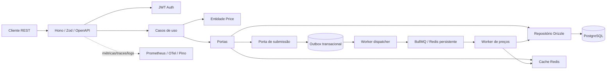

# Super API — comparação de preços de supermercados

Base inicial de API REST em **Bun + TypeScript strict + Hono + PostgreSQL/Drizzle + Redis/BullMQ**. O desenho é um monólito modular: um deploy simples agora, com limites claros para separar processos ou módulos quando a carga justificar.

## Executar localmente

Requisitos: Bun 1.3.14+, Docker Compose v2.

```sh
cp .env.example .env
# Troque JWT_SECRET e as senhas antes de expor qualquer serviço.
docker compose up --build
```

API (localhost): <http://localhost:3000>; Swagger: <http://localhost:3000/docs>; OpenAPI: <http://localhost:3000/openapi.json>; Prometheus: <http://localhost:9090>; Grafana: <http://localhost:3001> (dev: admin / change-this-in-production). PostgreSQL/Redis ficam apenas na rede interna do Compose; para testes locais fora dos containers, habilite o mapeamento de portas manualmente.

O Compose inicia API, worker, PostgreSQL, Redis de cache, Redis persistente de filas e Prometheus/Grafana. Os containers e credenciais padrão são **somente para desenvolvimento**; não exponha as portas de observabilidade, não use as senhas padrão e injete segredos por secret manager em produção. O Collector OTLP é iniciado no Compose local e API/worker exportam para `http://otel-collector:4318/v1/traces` por padrão; altere `OTEL_EXPORTER_OTLP_ENDPOINT` se necessário. Para um deploy que não use Collector, deixe essa variável vazia para desabilitar tracing.

Se `METRICS_TOKEN` estiver configurado, o scrape exige `Authorization: Bearer <token>`; configure o mesmo segredo no Prometheus para ambientes não isolados.

### Desenvolvimento e qualidade

```sh
bun install
bun run db:migrate
bun run db:seed
bun run dev                 # API com reload
bun run worker              # em outro terminal
bun run typecheck
bun run lint
bun run format:check
bun run test                # unitários + E2E em memória
RUN_INTEGRATION=1 bun run test:integration # PostgreSQL disponível
bun run test:e2e
```

`bun run db:migrate` executa as migrações Drizzle versionadas; `bun run db:generate` gera a próxima migração a partir do schema. Revise o SQL antes do deploy. Compose usa um serviço `migrate` único antes de iniciar API/worker e uma tabela dedicada no journal de migração. Compose configura `NODE_ENV=production`; antes de subir, defina `JWT_SECRET` e senhas fortes em `.env` (ou secret manager). O segredo JWT de desenvolvimento faz o processo falhar fechado nesse modo.

## Estrutura de pastas

```text
src/
├── config/                         # Configuração validada com Zod
├── domain/prices/                  # Entidade/regra de preço, independente de I/O
├── application/
│   ├── ports/                      # Contratos de repositório, cache e fila
│   └── use-cases/                  # Comparar, consultar histórico, submeter preço
├── http/
│   ├── middleware/                 # JWT
│   └── routes/                     # Rotas REST/OpenAPI, schema Zod
├── infrastructure/
│   ├── auth/                       # JWT e hashing scrypt
│   ├── cache/                      # Adaptador Redis
│   ├── database/                   # Schema Drizzle, cliente e repositório
│   ├── observability/              # Pino, OTel, Prometheus
│   └── queue/                      # BullMQ, worker e dispatcher outbox
├── main.ts                         # Inicialização HTTP
└── worker.ts                       # Processo de ingestão independente
drizzle/                            # SQL inicial e artefatos Drizzle
monitoring/                         # Prometheus, OTel Collector, Grafana
 tests/                             # unit, integration, e2e, support
```

### Diagrama de módulos



## Contratos REST

- `POST /api/v1/auth/register` — cria conta e retorna JWT de acesso (15 min).
- `POST /api/v1/auth/login` — autentica e retorna JWT de acesso.
- `GET /api/v1/prices/{productId}/compare?city=São%20Paulo&state=SP` — ofertas atuais em ordem crescente, moeda BRL e valores inteiros em centavos.
- `GET /api/v1/prices/{productId}/history?days=90&limit=500` — observações recentes, limitadas.
- `POST /api/v1/prices` — requer Bearer JWT e `Idempotency-Key: <UUID>`; retorna 202 após gravar na outbox, não após concluir o trabalho.
- `GET /health/live`, `GET /health/ready`, `GET /metrics`, `GET /openapi.json`, `GET /docs`.

Exemplo de ingestão:

```http
POST /api/v1/prices
Authorization: Bearer <accessToken>
Idempotency-Key: 123e4567-e89b-42d3-a456-426614174000
Content-Type: application/json

{"productId":"123e4567-e89b-42d3-a456-426614174000","storeId":"123e4567-e89b-42d3-a456-426614174001","priceCents":599,"source":"partner-feed"}
```

## Modelo de dados

- **users**: e-mail canônico, hash scrypt, data de criação.
- **products**: GTIN opcional (único quando preenchido), nome, marca, categoria e unidade.
- **stores**: cadeia e localização; índice `(state, city)`.
- **current_prices**: uma linha por `(product_id, store_id)`; índice `(product_id, price_cents)` para comparação ordenada e índice de unicidade do par.
- **price_history**: observações imutáveis, centavos, origem e data; PK composta `(observed_at, id)`, índices `(product_id, observed_at)` e `(store_id, observed_at)`.
- **outbox_events**: evento JSON e chave de idempotência única; índice parcial para eventos ainda não publicados; `attempts` e `last_error` registram as tentativas de publicação (o evento sai da seleção ao atingir 10 falhas, sem bloquear os demais).

Centavos inteiros evitam erros de ponto flutuante. `current_prices` não é uma agregação eventual: é atualizada na mesma transação que a inserção do histórico. Observações mais antigas não substituem o valor atual; comparações só retornam preços observados nos últimos 30 dias. A ingestão rejeita observações com mais de 5 minutos no futuro ou mais de 365 dias. A outbox fecha a janela de falha entre confirmar um request no PostgreSQL e publicar no Redis; o worker é idempotente e o dispatcher pode repetir entregas.

## Decisões e escalabilidade

1. **Monólito modular, não microserviços:** um domínio e um deploy fáceis de operar no MVP; portas explícitas deixam banco, cache e fila substituíveis. API e worker já escalam separadamente.
2. **Clean Architecture / SOLID:** domínio sem framework; casos de uso dependem de interfaces; Drizzle/Redis/BullMQ são adaptadores. Hono faz parsing, validação e tradução HTTP. Mantenha a composição de dependências na borda ao ampliar módulos.
3. **DDD leve:** `Price` contém as invariantes que realmente importam (preço positivo em centavos, data e identificadores válidos); Product e Store permanecem entidades relacionais simples até surgir comportamento próprio.
4. **Consulta quente curta:** comparação lê o snapshot `current_prices`, com filtro por produto/local e ordenação apoiada por índice; não varre o histórico. Resposta limitada a 100 ofertas.
5. **Histórico de milhões de linhas:** índice por produto e data; intervalo de consulta limitado, payload projetado e paginação/limite. Métricas de `EXPLAIN (ANALYZE, BUFFERS)` e volume determinam quando habilitar partições mensais por `observed_at`, retenção/arquivamento e ingestão em lote. Planeje a tabela particionada e unicidade local conscientemente: no PostgreSQL, índices únicos de tabelas particionadas normalmente precisam incluir a chave de partição; mantenha deduplicação global na outbox ou adote tabela de idempotência dedicada antes dessa migração.
6. **Redis de cache independente do Redis de fila:** cache usa `allkeys-lru` sem persistência; fila usa AOF e `noeviction`, pois expulsar chaves BullMQ corromperia o estado do job. Cache é best-effort, curto (60 s comparação, 300 s histórico), namespaced/versionado e invalidado após persistência. TTL limita inconsistências se invalidação falhar.
7. **Fila/outbox:** payload leve, tentativas exponenciais, worker concorrente e idempotência. O dispatcher publica em lote, contabiliza falhas por evento (`attempts`/`last_error`) e segue para o próximo, de modo que um evento envenenado não bloqueie o backlog; `outbox_backlog_events` e `outbox_dispatch_failures_total` expõem o backlog e as falhas. Redis de fila precisa persistência, monitoramento, backup/teste de recuperação e política de jobs falhos antes da produção. A entrega é at-least-once.
8. **Auth:** token JWT curto HS256 com emissor/audiência validados; segredo mínimo de 32 caracteres fora do código. Senha usa scrypt e comparação em tempo constante. Em produção, preferir chaves assimétricas/rotação, refresh revogável, rate limiting e controles de abuso.
9. **Observabilidade:** Pino JSON remove autorização/senhas; request-id correlaciona logs; OTel exporta traces OTLP quando configurado; Prometheus expõe séries de baixa cardinalidade (sem IDs individuais). Collector de exemplo exporta traces no log/debug, suficiente localmente — substitua por backend durável.
10. **Operação:** migração executada como etapa única, healthcheck de readiness, containers não-root/read-only e Compose focado em desenvolvimento. Produção demanda TLS, secrets, backups, pooling/limites de conexões, alertas, HA e revisão de segurança.

## Testes

- Unitários: invariantes de `Price`, cache-hit/miss do caso de comparação, JWT e hash de senha, e dispatcher da outbox (evento envenenado não bloqueia o lote, `attempts`/`last_error`, limite de tentativas).
- Integração (`RUN_INTEGRATION=1`): contra PostgreSQL real para snapshot e histórico, proteção contra eventos atrasados e seleção/atualização de eventos da outbox; CI provisiona Postgres e Redis.
- E2E: percorre a aplicação HTTP Hono por `app.request` sem abrir socket, validando OpenAPI, validação e proteção JWT. Para testes de socket/infra ponta a ponta, iniciar o Compose e exercitar o endpoint publicado num job de release.

## Roadmap

- **MVP:** catálogo/lojas por seed e gestão autenticada, comparação, histórico, ingestão outbox/BullMQ, JWT, cache, métricas e deploy Compose; contratos atuais implementam o núcleo de preços e cadastro/autenticação inicial.
- **V2:** APIs administrativas completas para catálogo/lojas, fontes de preço com importação bulk e dead-letter/replay, busca textual (trigram/FTS), paginação por cursor, alertas/listas de compras, refresh token e rate limiting; avaliar partição mensal, read replicas e CDN conforme telemetria.
- **V3:** múltiplas regiões/tenants, eventos de domínio para integrações, analytics/OLAP separado, previsão/qualidade de preços, políticas de retenção/arquivamento e particionamento distribuído só se o crescimento comprovado exigir.

## Convenções

ESLint + TypeScript strict, Prettier, Husky (lint/typecheck/unit pre-commit), Commitlint e Conventional Commits. Workflow GitHub Actions executa qualidade, integração e build de imagem no push para `main`.
